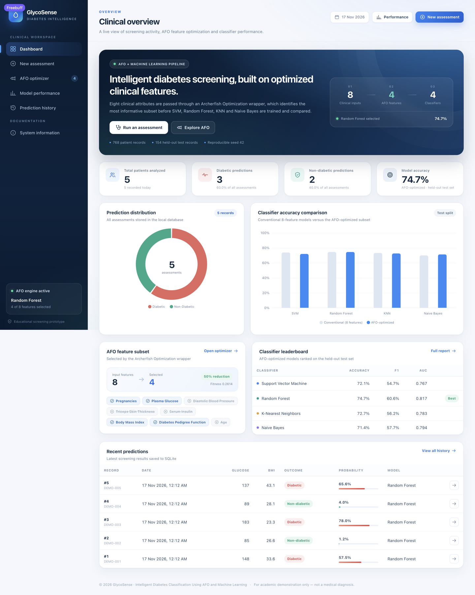
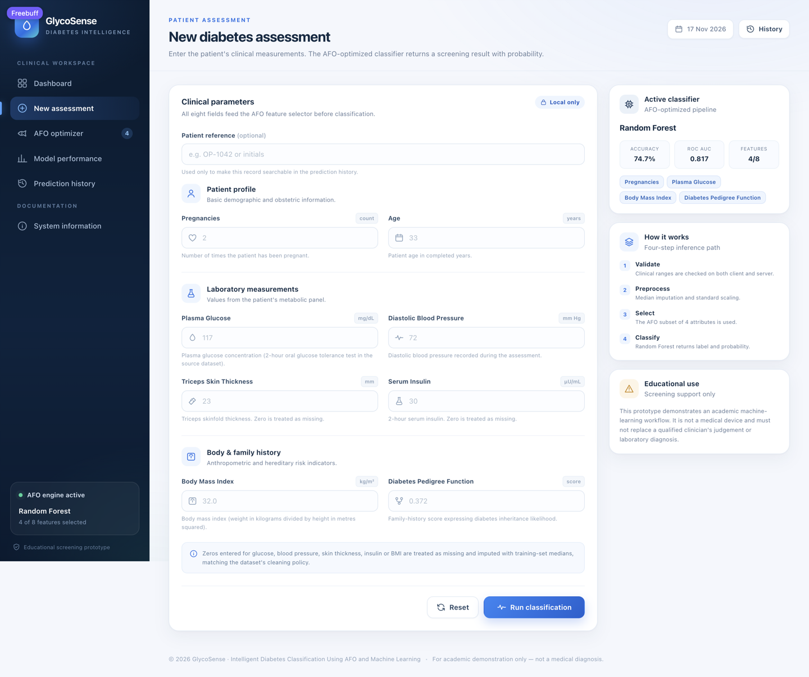
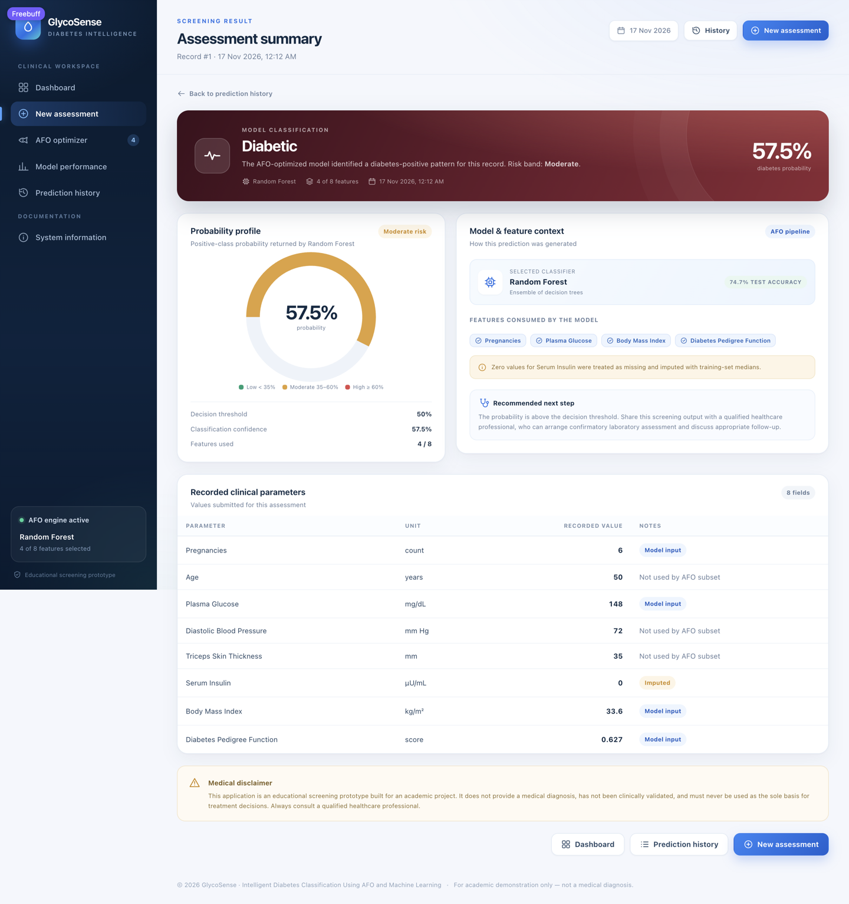
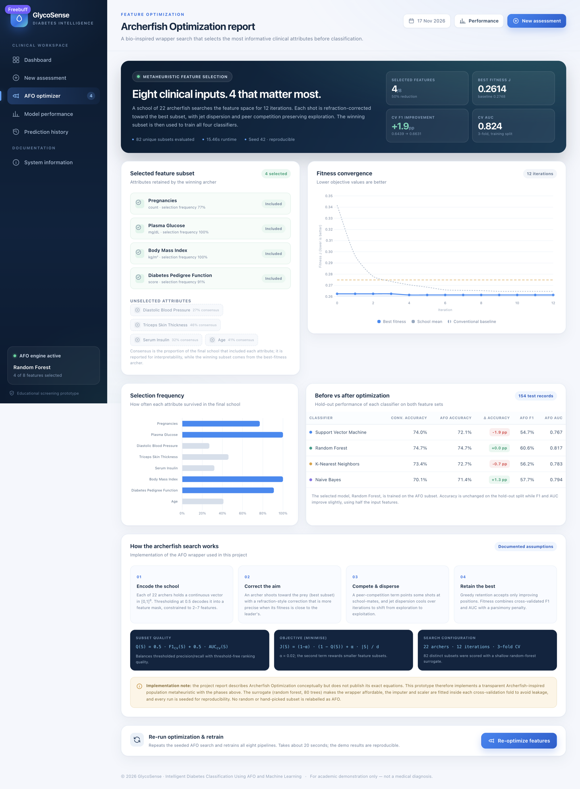
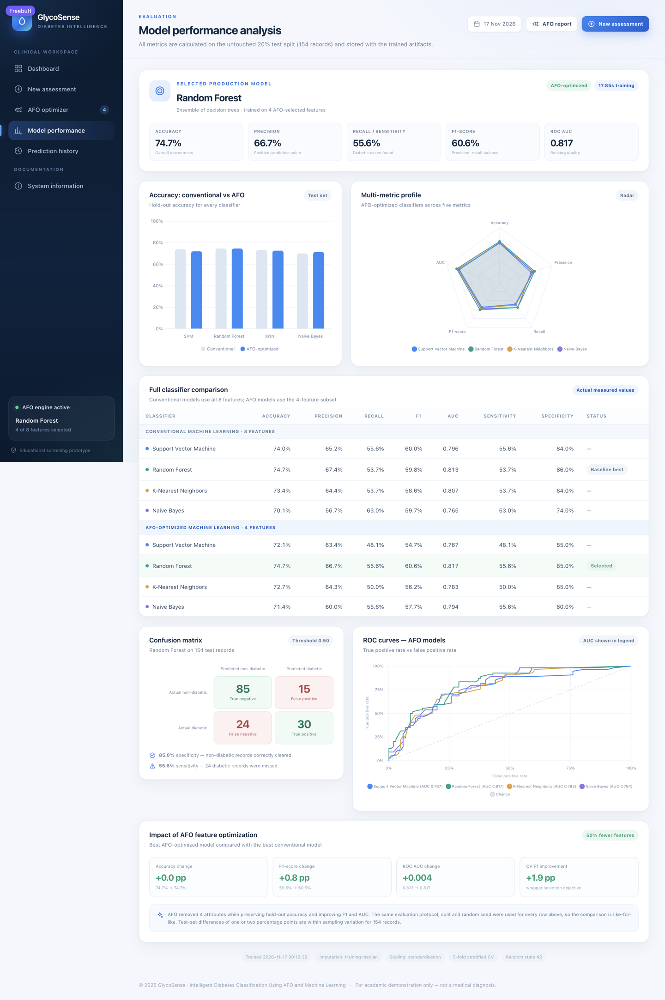
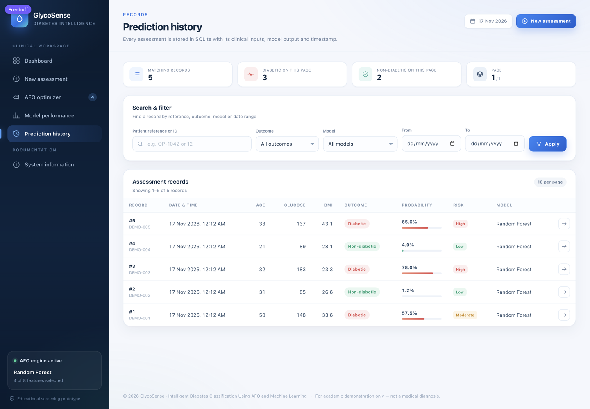
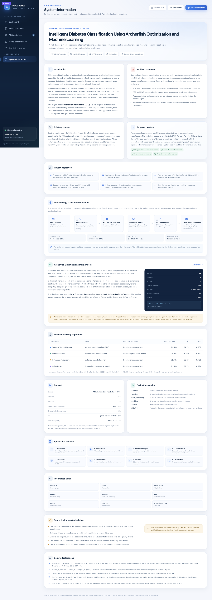

# Intelligent Diabetes Classification Using Archerfish Optimization and Machine Learning

A complete, locally runnable final-year engineering project prototype: **Flask + scikit-learn + Archerfish Optimization (AFO) + SQLite + Chart.js**, presented as a professional clinical screening dashboard.

> **Educational prototype — not a medical diagnosis.** The system is not clinically validated and must not be used for treatment decisions.



---

## At a glance

| Item | Value |
|---|---|
| Dataset | PIMA Indians Diabetes (768 records, 8 clinical features) |
| Train / test split | 614 / 154 (stratified 80/20, seed 42) |
| AFO feature selection | 8 → **4 features** (50% reduction) |
| Selected features | Pregnancies, Glucose, BMI, Diabetes Pedigree Function |
| Best classifier | **Random Forest** (AFO-optimized) |
| Test accuracy | **74.68%** |
| Precision / recall / F1 | 66.67% / 55.56% / **60.61%** |
| ROC AUC | **0.8170** |
| Conventional RF baseline | 74.68% accuracy, 59.79% F1, 0.8128 AUC |
| Interface | Responsive Flask app with 7 routes + JSON health check |
| Tests | **13 passed** (pytest integration suite) |

AFO removed half the input features, the selected Random Forest matched conventional hold-out accuracy, and F1 and AUC improved slightly. All reported numbers are computed from the saved run — none are hard-coded.

---

## Application modules

| # | Module | Route | What it does |
|---|---|---|---|
| 1 | Professional dashboard | `/` | Live patient counts, diabetic/non-diabetic split, model accuracy, prediction distribution, classifier leaderboard, recent history |
| 2 | Patient assessment | `/predict` | Eight clinical inputs with client + server validation, units, reset and loading state |
| 3 | ML prediction engine | POST `/predict` | Median imputation → standardisation → AFO-selected Random Forest → probability |
| 4 | AFO optimization report | `/afo` | Selected vs excluded features, convergence, selection frequency, before/after comparison, documented objective, re-run control |
| 5 | Prediction result | `/result/<id>` | Diabetic / non-diabetic verdict, probability gauge, risk band, model, important inputs, recommendation, disclaimer |
| 6 | Model performance | `/performance` | Accuracy, precision, recall, F1, AUC, sensitivity, specificity, confusion matrix, grouped bars, radar, ROC curves |
| 7 | Prediction history | `/history` | SQLite-backed search, outcome/model/date filters, pagination, probability bars |
| 8 | System information | `/about` | Introduction, problem statement, existing vs proposed system, objectives, methodology, architecture, AFO, algorithms, technologies, limitations |

Additional endpoint: `GET /api/health` returns the active model, feature count, accuracy and training timestamp.

---

## Screenshots

### 1. Dashboard


### 2. Patient assessment form



### 3. Prediction result



### 4. Archerfish Optimization report



### 5. Model performance analysis



### 6. Prediction history



### 7. System information



---

## Quick start

### Requirements

- Python 3.9 or newer (developed and tested with Python 3.9.6)
- No internet connection is required at run time — Chart.js is vendored locally and the dataset is included.
- Tested dependency versions: Flask 3.1.3, NumPy 2.0.2, Pandas 2.3.3, scikit-learn 1.6.1, joblib 1.5.3.

### macOS / Linux

Open a terminal **in the project folder** (`app.py` is here):

```bash
python3 -m venv .venv
source .venv/bin/activate
pip install -r requirements.txt

# One-time (artifacts are already included, but this reproduces them):
python train_models.py

python app.py
```

Open **http://127.0.0.1:5055**.

> On this laptop the `.venv` is already created and the trained artifacts are already present, so:
>
> ```bash
> source .venv/bin/activate
> python app.py
> ```
>
> is enough.

### Windows (PowerShell)

```powershell
python -m venv .venv
.\.venv\Scripts\Activate.ps1
pip install -r requirements.txt
python train_models.py
python app.py
```

The app deliberately uses port **5055** instead of Flask's default 5000, because macOS AirPlay often occupies port 5000.

If the port is busy:

```bash
PORT=5056 python app.py
```

### First run without artifacts

If `models/artifacts.joblib` is missing, `app.py` automatically runs the AFO + training pipeline on first start (about 20 seconds). You can also force a fresh run with `python train_models.py`.

---

## Dataset

The dataset is stored at `dataset/pima-indians-diabetes.csv`.

| Property | Value |
|---|---|
| Source | PIMA Indians Diabetes Dataset (UCI Machine Learning Repository), mirrored by the Plotly public datasets collection |
| Records | 768 |
| Features | Pregnancies, Glucose, BloodPressure, SkinThickness, Insulin, BMI, DiabetesPedigreeFunction, Age |
| Target | `Outcome` — 268 diabetic, 500 non-diabetic |
| Missing markers | 652 zeros across Glucose (5), BloodPressure (35), SkinThickness (227), Insulin (374), BMI (11) |
| File SHA-256 (short) | `698c203a14aa` |

Zero values in glucose, blood pressure, skin thickness, insulin and BMI are physiologically implausible. They are converted to `NaN` and imputed with the **training-fold median** inside each model pipeline. Pregnancies may legitimately be zero and is left unchanged.

Reproducibility helper:

```bash
python scripts/download_dataset.py
```

The downloader validates the header, 768 row count and class balance before overwriting the local CSV.

---

## Machine-learning pipeline

`ml/trainer.py` implements the complete reproducible pipeline:

1. **Load** the PIMA CSV.
2. **Clean** implausible zeros to missing values.
3. **Split** 80% training / 20% testing, stratified, `random_state=42`.
4. **Optimize features** with AFO on the training split only.
5. **Train** four classifiers twice — conventional (all 8 features) and AFO-optimized (4 features).
6. **Evaluate** on the untouched test split: accuracy, precision, recall, F1, AUC, sensitivity (recall), specificity, confusion matrix, ROC curve, 5-fold CV accuracy.
7. **Persist** the full pipeline bundle to `models/artifacts.joblib` and human-readable metadata to `models/metadata.json`.

Every pipeline is:

```
SimpleImputer(strategy="median")  →  StandardScaler()  →  classifier
```

so imputation and scaling are fitted **inside** every training fold and never leak test information.

### Classifiers and fixed hyperparameters

| Key | Classifier | Configuration |
|---|---|---|
| `svm` | Support Vector Machine | RBF kernel, C=1.0, gamma=`scale`, `probability=True` |
| `random_forest` | Random Forest | 200 trees, max depth 6, min samples per leaf 3 |
| `knn` | K-Nearest Neighbors | k=15, distance weighting |
| `naive_bayes` | Gaussian Naive Bayes | default variance smoothing |

Hyperparameters are fixed before evaluation; no test-set tuning is performed. The production model is selected on the AFO feature set by accuracy, then F1, then AUC.

---

## Actual evaluation results

Held-out test set: **154 records**. All values below are read from `models/metadata.json`.

### Conventional models (all 8 features)

| Classifier | Accuracy | Precision | Recall | F1 | AUC | Sensitivity | Specificity |
|---|---:|---:|---:|---:|---:|---:|---:|
| SVM | 74.03% | 65.22% | 55.56% | 60.00% | 0.7964 | 55.56% | 84.00% |
| Random Forest | **74.68%** | 67.44% | 53.70% | 59.79% | 0.8128 | 53.70% | 86.00% |
| KNN | 73.38% | 64.44% | 53.70% | 58.59% | 0.8069 | 53.70% | 84.00% |
| Naive Bayes | 70.13% | 56.67% | 62.96% | 59.65% | 0.7646 | 62.96% | 74.00% |

### AFO-optimized models (4 features)

| Classifier | Accuracy | Precision | Recall | F1 | AUC | Sensitivity | Specificity |
|---|---:|---:|---:|---:|---:|---:|---:|
| SVM | 72.08% | 63.41% | 48.15% | 54.74% | 0.7670 | 48.15% | 85.00% |
| **Random Forest** | **74.68%** | 66.67% | 55.56% | **60.61%** | **0.8170** | 55.56% | 85.00% |
| KNN | 72.73% | 64.29% | 50.00% | 56.25% | 0.7833 | 50.00% | 85.00% |
| Naive Bayes | 71.43% | 60.00% | 55.56% | 57.69% | 0.7944 | 55.56% | 80.00% |

### Selected model — Random Forest (AFO)

| Metric | Value |
|---|---:|
| Accuracy | 74.68% |
| Precision | 66.67% |
| Recall / sensitivity | 55.56% |
| Specificity | 85.00% |
| F1-score | 60.61% |
| ROC AUC | 0.8170 |
| 5-fold CV accuracy (training split) | 78.01% ± 2.15% |
| Confusion matrix | TN 85 · FP 15 · FN 24 · TP 30 |

### What AFO changed

| Comparison | Conventional best RF | AFO RF | Change |
|---|---:|---:|---:|
| Feature count | 8 | **4** | **−50%** |
| Accuracy | 74.68% | 74.68% | +0.0 pp |
| Precision | 67.44% | 66.67% | −0.8 pp |
| Recall | 53.70% | 55.56% | +1.9 pp |
| F1 | 59.79% | 60.61% | **+0.8 pp** |
| AUC | 0.8128 | 0.8170 | **+0.0042** |
| Wrapper CV F1 | 64.39% | 66.31% | **+1.9 pp** |
| Wrapper fitness J | 0.274843 | 0.261424 | **−0.013419** |

**Honest interpretation.** AFO is not a guarantee of higher test accuracy. On this split, two AFO models (SVM, KNN) performed slightly worse, Naive Bayes improved, and the selected Random Forest matched accuracy while using half the inputs and improving F1/AUC. With only 154 test records, differences of one or two percentage points are within sampling noise. The performance page shows every result rather than hiding unfavourable rows.

---

## Archerfish Optimization — implementation details

The project report describes AFO conceptually but does not publish its exact equations. This project therefore implements a **transparent Archerfish-inspired wrapper metaheuristic** — not a renamed random selector. The full method is visible in `ml/afo.py`, on the `/afo` page and on `/about`.

### Representation

Each archer is a continuous position `x ∈ [0,1]^d` (`d = 8`). A position is decoded into a feature mask by thresholding at 0.5. The subset is constrained to **2–7 features** so it can never become empty or trivially "all features".

### Search mechanics

```text
ρ_i(t) = 1 / (1 + β · |f_i(t) − f_best(t)|)        aim correction
target = a competing peer (probability p_c) or the prey (best subset)
v_i(t+1) = w·v_i(t)
         + c1·r1·(target − x_i(t))·ρ_i(t)
         + c2·r2·(x_best − x_i(t))·(1 − ρ_i(t))
         + η(t)·N(0,1)
x_i(t+1) = reflect_off_water_surface(x_i(t) + v_i(t+1))
η(t) = η0 · (1 − t/T)                              jet dispersion cooling
```

- **Aim correction:** an archer whose fitness is close to the leader takes a more precise, prey-directed shot.
- **Competition:** with a small decreasing probability an archer follows a peer instead of the prey, preserving exploration.
- **Dispersion:** the water-jet spread cools over iterations, shifting from exploration to exploitation.
- **Boundary:** positions outside `[0,1]` are reflected at the "water surface", then clamped.
- **Retention:** a new position replaces the old one only if its fitness improves. One archer starts at the all-feature corner (decoded to a near-full subset because subset size is capped at 7); the rest start randomly.

### Fitness function

```text
Q(S) = 0.5 · F1_cv(S) + 0.5 · AUC_cv(S)
J(S) = (1 − α) · (1 − Q(S)) + α · |S| / d
```

- `F1_cv` balances precision and recall at the 0.5 threshold.
- `AUC_cv` rewards ranking quality independently of the threshold.
- `α = 0.02` penalises large subsets. Lower `J` is better.
- 3-fold stratified CV on the **training split only**.
- A shallow random-forest surrogate (80 trees, max depth 6) captures non-linear interactions while keeping the wrapper affordable.
- Every decoded mask is cached, so repeated candidates are not re-evaluated.

### Configuration and measured run

| Parameter | Value |
|---|---:|
| Archers | 22 |
| Iterations | 12 |
| Inertia `w` | 0.55 |
| Prey attraction `c1` | 1.25 |
| Peer pull `c2` | 0.55 |
| Initial dispersion `η0` | 0.35 |
| Refraction coefficient `β` | 6.0 |
| Competition probability `p_c` | 0.22 → 0.04 |
| CV folds | 3 |
| Parsimony weight `α` | 0.02 |
| Surrogate | Random forest (80 trees, depth 6) |
| Random seed | 42 |
| Unique subsets evaluated | 82 |
| AFO runtime | 15.46 s |
| Selected features | 4 of 8 |
| Selection frequency | Glucose 100%, BMI 100%, DPF 90.9%, Pregnancies 77.3%, Skin 45.5%, Age 40.9%, Insulin 31.8%, BP 27.3% |

### Documented assumptions

1. Exact AFO equations are not specified in the source report; the implementation above is an Archerfish-inspired population algorithm with clearly named phases.
2. The surrogate is a random forest rather than the final classifier, so the search is model-agnostic and fast. The final four classifiers are trained afterwards on the winning subset.
3. The wrapper sees only the 614 training records; the 154 test records are used once for final metrics.
4. The search is seeded and deterministic. Re-running "Re-optimize features" reproduces the same subset and metrics on this machine.
5. Subset size is constrained to 2–7 features.
6. The search is a wrapper, not a filter: candidate subsets are scored by cross-validated predictive performance, not by correlation alone.

---

## How each module works

### 1. Dashboard (`/`)

`database/db.py` aggregates total, diabetic, non-diabetic and average probability counts. The page combines those with `models/metadata.json` (accuracy, selected features, model comparison) and the six latest prediction rows. Chart.js renders a doughnut distribution and a grouped accuracy comparison, both fed from server-side JSON. With an empty database, the cards show zero and the tables show a call to action rather than fake data.

### 2. Patient assessment (`/predict`)

`FIELD_SPECS` in `app.py` is the single source of truth for labels, units, ranges and help text. The same definitions generate the form and drive server-side validation (`0–20` pregnancies, `0–400` mg/dL glucose, etc.). JavaScript validates required values and ranges before submission, shows inline errors, and displays a loading overlay. Values are preserved after a server-side validation error. Optional patient reference is limited to 60 characters.

### 3. Prediction engine

`ml/service.py` loads the persisted bundle once. Only the AFO-selected columns are passed to the saved pipeline. Zeros in the five implausible fields are converted to `NaN`, then the training median imputer and scaler run, followed by the selected Random Forest. The positive-class probability and a 0.5 decision threshold produce the label. No sample outputs or placeholders exist in the prediction path.

### 4. AFO optimizer (`/afo`)

Runs described above. The page shows selected and excluded attributes with consensus frequencies, fitness convergence (best and school mean against the conventional baseline), a frequency chart, and a before/after accuracy table for all four classifiers. "Re-optimize features" repeats the seeded search and retrains all eight pipelines, then swaps the in-memory model. A lock prevents concurrent retraining.

### 5. Result (`/result/<id>`)

The prediction is inserted into SQLite and the user is redirected to a permanent result URL. The page recovers the saved inputs, model name, probability and risk band. The gauge colours low (<35%), moderate (35–60%) and high (≥60%) probability. A recommendation and a prominent medical disclaimer are always shown, and zero-imputed fields are labelled.

### 6. Performance (`/performance`)

Reads all eight configurations from the artifact metadata and renders the complete comparison table, a grouped accuracy chart, a five-axis radar profile, ROC curves for the four AFO models, and the selected model's confusion matrix. No metric is recalculated in the template; values come directly from the saved evaluation.

### 7. History (`/history`)

Parameterised SQL with `LIKE` search on patient reference or exact ID, plus outcome, model, `date_from` and `date_to` filters and 10-row pagination. Every query uses bound parameters. Probability bars and risk tags are derived from stored values.

### 8. Information (`/about`)

Static project documentation aligned with the report: introduction, problem statement, existing and proposed systems, objectives, six-stage architecture, AFO explanation and assumptions, classifier table with live metrics, dataset facts, evaluation definitions, module map, technology stack, limitations and references.

---

## System architecture

```text
Browser (HTML/CSS/JS + Chart.js)
              │
              ▼
        Flask routes (app.py)
              │
     ┌────────┴─────────┐
     ▼                  ▼
PredictionService    SQLite (database/db.py)
(ml/service.py)      predictions table
     │
     ▼
joblib artifact
imputer → scaler → AFO-selected Random Forest
```

Data pipeline:

```text
PIMA CSV → clean zeros → stratified 80/20 split → AFO wrapper
        → 4-feature subset → median impute + scale
        → SVM / Random Forest / KNN / Naive Bayes
        → held-out evaluation → best model persisted → Flask UI
```

---

## Project structure

```text
app.py                      Flask application, routes, validation, startup
train_models.py             Reproducible AFO + ML training entry point
requirements.txt            Runtime dependencies
README.md                   This document
DEMO_GUIDE.md               Step-by-step professor demonstration script
pytest.ini                  Test configuration

ml/
  __init__.py
  data.py                   Dataset loading, cleaning, metadata
  afo.py                    Archerfish Optimization feature selector
  trainer.py                Four classifiers × two feature sets + metrics
  service.py               Loads artifacts and scores patient records

dataset/
  pima-indians-diabetes.csv  Public PIMA dataset (768 × 8)

models/
  artifacts.joblib          Fitted pipelines + metrics + AFO trace
  metadata.json             Human-readable copy without pickled objects

database/
  __init__.py
  db.py                     SQLite schema, inserts, filters, statistics
  diabetes.db               Created automatically; contains 5 demo records

templates/
  base.html                 Sidebar, topbar, flash messages, shared shell
  dashboard.html            Module 1
  predict.html              Module 2
  result.html               Module 5
  performance.html          Module 6
  afo.html                  Module 4
  history.html              Module 7
  about.html                Module 8
  error.html                404/500 page
  _icons.html               Inline SVG icon macro

static/
  css/style.css             Complete responsive design system
  js/app.js                 Navigation, flashes, validation, loading state
  js/dashboard.js           Dashboard charts
  js/afo.js                 Convergence and frequency charts
  js/performance.js         Accuracy, radar and ROC charts
  js/result.js              Probability gauge
  js/vendor/chart.umd.min.js  Chart.js 4.4.7, served locally
  images/favicon.svg

scripts/
  download_dataset.py       Re-download and validate the PIMA CSV

tests/
  test_app.py               13 integration tests

screenshots/                7 full-page application screenshots
```

---

## Database

SQLite file: `database/diabetes.db`. The schema is created automatically at startup.

```sql
CREATE TABLE predictions (
    id INTEGER PRIMARY KEY AUTOINCREMENT,
    created_at TEXT NOT NULL,
    patient_ref TEXT,
    pregnancies REAL NOT NULL,
    glucose REAL NOT NULL,
    blood_pressure REAL NOT NULL,
    skin_thickness REAL NOT NULL,
    insulin REAL NOT NULL,
    bmi REAL NOT NULL,
    dpf REAL NOT NULL,
    age REAL NOT NULL,
    prediction INTEGER NOT NULL CHECK (prediction IN (0, 1)),
    probability REAL NOT NULL,
    model_key TEXT NOT NULL,
    model_name TEXT NOT NULL,
    risk_level TEXT NOT NULL,
    selected_features TEXT
);
```

The shipped database contains five sample assessments generated through the real prediction route (DEMO-001 … DEMO-005), so the dashboard and history screenshots are populated. To start with a clean history:

```bash
rm database/diabetes.db
python app.py          # schema is recreated automatically
```

This deletes the demonstration records permanently. The five records can be regenerated using the sample inputs in `DEMO_GUIDE.md`.

---

## Testing and verification

```bash
source .venv/bin/activate
python -m pytest -q
```

Result on this machine:

```text
............                                                             [100%]
13 passed in 3.59s
```

The tests cover:

- all six HTML pages render with the shared shell;
- 404 handling;
- server-side form validation (empty and out-of-range values);
- a complete prediction POST, database insert and result page;
- history search and no-match state;
- model service readiness, AFO subset size and probability bounds;
- JSON health payload;
- the Re-optimize AFO route, flash message and in-memory model reload.

Browser verification performed at 1440 × 1000 on the local Flask server:

- all pages loaded with **no console errors**;
- Chart.js assets and CSS returned HTTP 200;
- dashboard charts, AFO convergence, performance charts, ROC curves and result gauge rendered;
- the assessment form and a real prediction were submitted, creating records 1–5;
- search and filter behavior was exercised by the automated history tests;
- full-page screenshots were captured and inspected.

Not performed: clinical validation, multi-user security testing, load testing, or testing on mobile devices. The interface is responsive by construction (CSS breakpoints at 1200/1024/860/640 px) but was visually reviewed at desktop width only.

---

## Reproducing and retraining

```bash
python train_models.py
```

This rewrites `models/artifacts.joblib` and `models/metadata.json`. Training takes about 18 seconds on this laptop, of which AFO takes about 15.5 seconds. Restart `app.py` afterwards if it is already running (the app loads artifacts at startup), or use the "Re-optimize features" button, which reloads the in-memory service automatically.

Delete the artifacts and start the app to test the automatic first-run training path:

```bash
rm models/artifacts.joblib models/metadata.json
python app.py
```

---

## Troubleshooting

| Problem | Fix |
|---|---|
| `ModuleNotFoundError: flask` | Activate the virtual environment, then `pip install -r requirements.txt`. |
| `Address already in use` | Run `PORT=5056 python app.py` (macOS/Linux) or `$env:PORT=5056; python app.py` (PowerShell). |
| `Model artifacts not found` | Run `python train_models.py`; or let `app.py` auto-train on first start. |
| Blank charts | Confirm `static/js/vendor/chart.umd.min.js` exists and hard-refresh (`Cmd/Ctrl + Shift + R`). |
| Dashboard shows zero patients | History is empty. Submit an assessment or restore a database file. |
| `database` folder missing | It is created automatically; ensure the project folder is writable. |
| Re-optimize button takes ~20 s | Expected: it reruns 82 AFO subset evaluations and retrains eight pipelines. |
| Tests collect the old CLI prototype | Run `python -m pytest -q`; `pytest.ini` scopes collection to `tests/`. |

---

## Limitations

- The PIMA cohort contains 768 female patients of Pima Indian heritage; results may not generalise to other populations.
- Only one dataset and one stratified hold-out split are used. No external or multi-centre validation was performed.
- The 154-record test set makes small metric differences statistically uncertain.
- Treating zeros as missing is a documented dataset-specific heuristic.
- The application has no authentication, CSRF protection or hardened production configuration; it is intended for local academic demonstration only.
- Probability outputs are model estimates, not calibrated clinical risk scores.

**This system is an educational screening prototype, not a medical diagnosis.** Always consult a qualified healthcare professional.

---

## References

1. Suresh, H. R., Davamani, K. A., Chandrasekaran, H., & Sankar, N. P. (2025). Dual Multi Scale Attention Network Optimized With Archerfish Hunting Optimization Algorithm for Diabetics Prediction. *Microscopy Research and Technique*, 88(4), 947–958.
2. Behzadi, P., Farhadi, A., Nazari, E., & Bagheri, R. (2024). Optimized classification of diabetes using dynamic waterwheel plant optimization algorithm. *Scientific Reports*.
3. Chellappan, D., & Rajaguru, H. (2024). Machine learning meets meta-heuristics: BESO and RDO for feature selection in Type II diabetes diagnosis. *Bioengineering*, 11(8), 766.
4. Zhu, Y., Zhang, M., Huang, Q., Wu, X., Wan, L., & Huang, J. (2025). Secretary bird optimization algorithm based on quantum computing and multiple strategies improvement for KELM diabetes classification. *Scientific Reports*, 15, 87285.
5. Rana, M. M., Chowdhury, F. I., & Rodela, A. T. (2025). Diabetes prediction using feature selection algorithms and boosting-based machine learning classifiers. *Diagnostics*, 15(20), 2622.

---

**Demo tomorrow?** Follow [DEMO_GUIDE.md](DEMO_GUIDE.md) for a timed walkthrough, exact sample inputs and likely viva questions.
